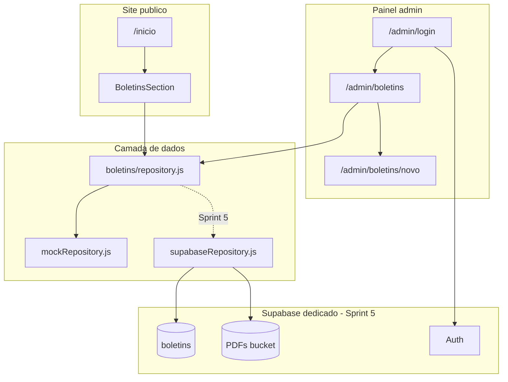

# Plano MVP — Boletins Moacyr Contábil

Documento de planejamento para implementação da área de Boletins no site Moacyr Contábil.  
**Proposta fechada:** R$ 650 (50% início / 50% entrega) | **Prazo:** 7 a 10 dias úteis

---

## 1. Escopo fechado

O cliente (Moacyr) aprovou o seguinte escopo:

| Item | Descrição |
|------|-----------|
| Seção na home | Lista com data, título e link para abrir o PDF |
| Painel admin | Login para cadastrar e remover boletins |
| Upload de PDF | Armazenamento na nuvem (não no site) |
| Layout | Alinhado ao site atual (cores, fontes, responsivo) |

**Fluxo do usuário final:** visita a home → vê os boletins → clica no título → abre o PDF em nova aba.

**Fluxo do admin (Moacyr):** acessa `/admin/login` → publica boletim (título + data + PDF) → visitantes veem na home.

---

## 2. Fora do escopo (permanente)

**Os itens abaixo NÃO serão implementados em momento algum neste projeto.** Não existe "Fase 2" planejada.

- Cadastro de inscritos por e-mail
- LGPD / lista de assinantes / consentimento de newsletter
- Formulário "Receber boletins por e-mail"
- Disparo automático de boletins por e-mail (Resend ou outro)
- Manutenção mensal R$ 80/mês como produto/feature do sistema
- Calendário de obrigações, notícias, cotação de moedas (como sites de referência maiores)

O Resend existente em `src/app/api/send/route.js` permanece **apenas** para formulários de contato e currículo já existentes. Não será estendido para boletins.

---

## 3. Situação atual do Supabase

**Não existe Supabase configurado no moacyrcontabil hoje.**

Evidências no repositório (verificado em jul/2026):

- Nenhuma dependência `@supabase/*` em `package.json`
- Nenhuma referência a `supabase` ou variáveis `SUPABASE_*` no código-fonte
- Nenhuma pasta `supabase/migrations`
- Variáveis de ambiente em uso hoje: apenas **Resend** (`RESEND_API_KEY`, `RESEND_FROM_EMAIL`, `RESEND_TO_EMAIL`)

**Ação necessária:** criar um **projeto Supabase novo e dedicado** exclusivamente para o Moacyr Contábil (Auth + Postgres + Storage). Essa configuração é a **última sprint** (Sprint 5), após UI, painel e camada de dados estarem prontos com mock.

---

## 4. Stack e padrões visuais

Respeitar o que já existe no projeto. Não reinventar design.

| Aspecto | Padrão atual |
|---------|--------------|
| Framework | Next.js 14 App Router, JavaScript |
| Estilo | Tailwind CSS |
| Cores | `brand-yellow` (#F6BE25), `brand-dark` (#323231), `brand-green` (#24B600), fundo `#E9E9E9` |
| Fonte | Montserrat (`src/app/layout.js`) |
| Container | Classe `.site-wrap` (`src/app/globals.css`) — max-width 80rem, padding responsivo |
| Breakpoints | `lg` 1024px, `lmd` 1440px, `xlg` 1920px |
| Componentes | Reutilizar `Input.jsx`, `Button.jsx`, `FileButton.jsx`, `LinkButton.jsx` |
| Home | `src/app/inicio/page.js` — inserir Boletins após `InfoSection` |
| Seções irmãs | `servicesShowcaseSection.jsx`, `infoSection.jsx` como referência de layout |

---

## 5. Arquitetura



**Estratégia:** Sprints 1–4 usam `mockRepository`. Sprint 5 troca por `supabaseRepository` sem refatorar UI.

---

## 6. Modelo de dados

Tabela `boletins` (criada na Sprint 5):

| Campo | Tipo | Notas |
|-------|------|-------|
| `id` | uuid | PK, `gen_random_uuid()` |
| `title` | text | Título exibido na lista |
| `published_at` | date | Data exibida (formato DD/MM/YYYY na UI) |
| `pdf_path` | text | Caminho no Storage, ex: `boletins/2026-07-11-slug.pdf` |
| `pdf_url` | text | URL pública do PDF |
| `created_at` | timestamptz | Auditoria |
| `is_published` | boolean | Default `true` |

Bucket Storage: `boletins` — leitura pública dos PDFs; upload/delete só usuário autenticado.

---

## 7. Sprints e prompts para o Agent

Ordem de execução: **S1 → S2 → S3 → S4 → S5**. Executar prompts sequencialmente dentro de cada sprint.

---

### Sprint 1 — Seção Boletins na home (mock)

**Dias:** 1–2 | **Objetivo:** Visitante vê a lista na home com layout final, usando dados mock.

**Arquivos a criar/alterar:**

- `src/data/boletins.mock.js` (novo)
- `src/app/inicio/boletinsSection.jsx` (novo)
- `src/app/inicio/page.js` (alterar)

#### Prompt 1.1 — Dados mock e componente BoletinsSection

```
No projeto moacyrcontabil (Next.js 14, App Router, JavaScript):

1. Crie src/data/boletins.mock.js com 5 boletins de exemplo:
   - Campos: id, title, published_at (ISO date), pdf_url (link para PDF público de exemplo ou placeholder)
   - Títulos realistas de contabilidade/fiscal em português

2. Crie src/app/inicio/boletinsSection.jsx como Server Component:
   - Importa dados de boletins.mock.js (temporário)
   - Cabeçalho "Boletins" com ícone lucide-react Bookmark
   - Lista vertical: cada item exibe "DD/MM/YYYY - Título" como link
   - Link abre PDF em nova aba (target="_blank" rel="noopener noreferrer")
   - Estilo: fundo card claro, borda/sombra leve, cores brand-dark e hover brand-yellow
   - Usar w-full; NÃO adicionar site-wrap duplicado (o pai MainSection já tem)
   - Responsivo: mobile lista full-width; desktop mesma largura das seções acima
   - Se lista vazia: não renderizar a seção
   - Criar helper formatBoletimDate em src/helpers/boletins.js se necessário

3. Não alterar outras páginas ainda.
4. Respeitar Montserrat, #E9E9E9, #F6BE25, #323231.
```

#### Prompt 1.2 — Integrar na home

```
Em src/app/inicio/page.js:

1. Importe BoletinsSection
2. Posicione após InfoSection, dentro de MainSection
3. Adicione id="boletins" e className scroll-mt-24 na seção para âncora futura
4. Não alterar HeroSection, ServicesShowcaseSection, InfoSection nem seções de contato/currículos
5. Rode npm run build e corrija erros se houver
```

**Critério de aceite Sprint 1:**

- [ ] Home exibe seção Boletins com 5 itens mock
- [ ] Formato "DD/MM/YYYY - Título" correto
- [ ] Links abrem em nova aba
- [ ] Layout alinhado com seções acima em desktop e mobile
- [ ] `npm run build` passa

---

### Sprint 2 — Painel admin (UI sem banco)

**Dias:** 3–5 | **Objetivo:** Telas do painel prontas; persistência ainda mock/local.

**Arquivos a criar:**

- `src/app/admin/layout.js`
- `src/app/admin/login/page.js`
- `src/app/admin/boletins/page.js`
- `src/app/admin/boletins/novo/page.js`

#### Prompt 2.1 — Layout admin e tela de login (UI)

```
Crie a área admin em src/app/admin/:

1. admin/layout.js:
   - Layout separado do site público (sem Navbar/Footer globais do layout.js raiz — usar route group ou layout que substitua visual)
   - Header simples: "Moacyr Contábil — Painel", link "Voltar ao site" (/inicio), botão Sair (placeholder)
   - Fundo #E9E9E9 ou branco, acentos brand-yellow e textos brand-dark
   - Montserrat herdada

2. admin/login/page.js ("use client"):
   - Formulário email + senha usando Input.jsx e Button.jsx existentes
   - Estilo consistente com o site
   - Submit: por enquanto redireciona para /admin/boletins (auth real na Sprint 5)
   - Mensagem de erro genérica em português se campos vazios
   - Centralizado, card com sombra leve

3. Não instalar Supabase ainda.
```

#### Prompt 2.2 — Listagem de boletins no painel

```
Crie src/app/admin/boletins/page.js:

1. Lista boletins de src/data/boletins.mock.js (temporário)
2. Exibe: título, data formatada, link "Ver PDF", botão Excluir
3. Botão "Novo boletim" → /admin/boletins/novo (Button.jsx / LinkButton.jsx)
4. Excluir: remove do estado local ou mock em memória (persistência real na Sprint 3+)
5. Empty state: "Nenhum boletim publicado ainda" + CTA novo boletim
6. Mobile: cards empilhados; desktop: tabela ou lista espaçada
7. Cores do site (brand-yellow em CTAs)
```

#### Prompt 2.3 — Formulário novo boletim

```
Crie src/app/admin/boletins/novo/page.js ("use client"):

1. Campos:
   - Título (obrigatório, Input.jsx)
   - Data de publicação (input type="date", default hoje)
   - Arquivo PDF (input file accept=".pdf" ou FileButton.jsx)

2. Botão "Publicar" (Button.jsx)
3. Submit: por enquanto adiciona ao mock em memória / estado e redireciona para /admin/boletins
4. Validação client-side: título preenchido, arquivo selecionado, extensão .pdf
5. Loading no botão durante submit simulado
6. Erros em português acima do formulário
7. Link "Cancelar" volta para /admin/boletins
```

**Critério de aceite Sprint 2:**

- [ ] `/admin/login` renderiza e redireciona para listagem
- [ ] `/admin/boletins` lista boletins mock
- [ ] `/admin/boletins/novo` aceita formulário e volta para listagem
- [ ] Layout admin visualmente alinhado ao site
- [ ] Responsivo mobile/desktop

---

### Sprint 3 — Camada de dados abstraída + API

**Dias:** 6–7 | **Objetivo:** Código preparado para trocar mock por Supabase sem refatorar UI.

**Arquivos a criar:**

- `src/helpers/boletins.js`
- `src/lib/boletins/repository.js`
- `src/lib/boletins/mockRepository.js`
- `src/app/api/admin/boletins/route.js`
- `src/app/api/admin/boletins/[id]/route.js`
- `src/app/api/boletins/route.js`
- `src/middleware.js`

#### Prompt 3.1 — Helpers e repository pattern

```
1. Crie src/helpers/boletins.js:
   - formatBoletimDate(date) → "DD/MM/YYYY" pt-BR
   - validateBoletimPayload({ title, published_at, file }) → { valid, errors[] } em português
   - mapBoletimRow(row) → objeto normalizado para UI
   - generatePdfSlug(title) → slug seguro para nome de arquivo

2. Crie src/lib/boletins/repository.js:
   - Exporta funções: getPublishedBoletins(limit), getAllBoletins(), createBoletim(data), deleteBoletim(id)
   - Delega para implementação ativa (mock por padrão)

3. Crie src/lib/boletins/mockRepository.js:
   - Implementação em memória + persistência em arquivo JSON local data/boletins.store.json (gitignore)
   - PDFs mock: salvar em public/boletins-temp/ temporariamente (gitignore) até Sprint 5
   - Ordenar por published_at DESC

4. Adicione data/boletins.store.json e public/boletins-temp/ ao .gitignore
```

#### Prompt 3.2 — API routes

```
Crie rotas API:

1. GET src/app/api/boletins/route.js (público):
   - Retorna boletins publicados via repository
   - JSON { boletins: [...] }

2. POST src/app/api/admin/boletins/route.js:
   - Auth temporária: header Authorization ou cookie admin_session (middleware)
   - FormData: title, published_at, file (PDF)
   - Valida com validateBoletimPayload
   - Max 10MB, só application/pdf
   - Chama repository.createBoletim
   - Retorna 201 { id, title, pdf_url }

3. DELETE src/app/api/admin/boletins/[id]/route.js:
   - Auth temporária obrigatória
   - Chama repository.deleteBoletim(id)
   - Retorna 204 ou 404

4. Usar NextResponse e runtime nodejs onde necessário para upload
```

#### Prompt 3.3 — Middleware de proteção admin

```
Crie src/middleware.js na raiz:

1. Proteger rotas /admin/* exceto /admin/login
2. Auth temporária até Sprint 5:
   - Variável de ambiente ADMIN_PASSWORD + cookie simples após login
   - Ou sessão mock com email/senha fixos em .env (ADMIN_EMAIL, ADMIN_PASSWORD)
3. Login em /admin/login seta cookie de sessão via API route src/app/api/admin/login/route.js
4. Redirect não autenticado → /admin/login
5. Não interferir em /inicio, /contato, /servicos, /api/send, etc.
6. Documentar variáveis em .env.example
```

**Critério de aceite Sprint 3:**

- [ ] GET /api/boletins retorna lista
- [ ] POST /api/admin/boletins cria boletim (com auth)
- [ ] DELETE remove boletim (com auth)
- [ ] Middleware bloqueia /admin sem login
- [ ] Repository abstrato permite swap futuro

---

### Sprint 4 — Integração end-to-end (mock) + QA

**Dias:** 8–9 | **Objetivo:** Fluxo completo com mock antes de conectar Supabase.

**Arquivos a alterar/criar:**

- `src/app/inicio/boletinsSection.jsx` — consumir repository/API
- `src/app/admin/boletins/*` — consumir API
- `docs/PAINEL-BOLETINS.md` (novo)

#### Prompt 4.1 — Integração home e painel com API

```
1. Atualize boletinsSection.jsx:
   - Remover import direto de boletins.mock.js
   - Buscar via getPublishedBoletins() do repository (Server Component)

2. Atualize admin/boletins/page.js:
   - Listar via GET repository ou fetch /api/boletins + rota admin
   - Excluir via DELETE /api/admin/boletins/[id]
   - Revalidar ou router.refresh após mutações

3. Atualize admin/boletins/novo/page.js:
   - POST /api/admin/boletins com FormData
   - Tratar erros da API

4. Atualize admin/login/page.js:
   - POST /api/admin/login com credenciais
   - Redirect após sucesso

5. Fluxo completo: login → criar boletim → aparece na home após refresh
```

#### Prompt 4.2 — QA e checklist

```
Execute e documente no final desta sprint:

Checklist manual:
- [ ] npm run build sem erros
- [ ] Home sem boletins: seção oculta ou empty state correto
- [ ] Home com 3+ boletins: ordenados por data DESC
- [ ] Mobile 375px: legível e clicável
- [ ] Desktop 1440px: alinhado com InfoSection/ServicesShowcase
- [ ] Login inválido: erro em português
- [ ] Logout limpa sessão
- [ ] Excluir boletim remove da home
- [ ] Upload rejeita arquivo não-PDF
- [ ] Upload rejeita arquivo > 10MB

Corrija bugs encontrados. NÃO adicionar escopo excluído (e-mail, LGPD, etc.).
```

#### Prompt 4.3 — Documentação para o cliente

```
Crie docs/PAINEL-BOLETINS.md em português simples (máximo 1 página):

1. O que é a área de Boletins na home
2. URL do painel: /admin/login
3. Como fazer login (credenciais fornecidas pelo desenvolvedor)
4. Passo a passo: publicar boletim (título + data + PDF)
5. Como excluir um boletim
6. O que o visitante vê no site
7. Limites: só PDF, tamanho máximo 10MB
8. Contato para suporte (Isaac)

Linguagem não técnica, para o Moacyr usar sem ajuda diária.
```

**Critério de aceite Sprint 4:**

- [ ] Fluxo login → criar → home → excluir funciona
- [ ] `npm run build` passa
- [ ] `docs/PAINEL-BOLETINS.md` criado
- [ ] Checklist QA marcado

---

### Sprint 5 — Supabase dedicado (ÚLTIMA)

**Dias:** 10+ | **Objetivo:** Projeto Supabase novo só para Moacyr; substituir mock por produção.

**Pré-requisito manual (Isaac):** criar projeto em [supabase.com](https://supabase.com), anotar URL e keys.

**Arquivos a criar/alterar:**

- `package.json` — deps Supabase
- `src/lib/supabase/client.js`, `server.js`
- `supabase/migrations/001_boletins.sql`
- `src/lib/boletins/supabaseRepository.js`
- `.env.example`
- Remover auth mock e store JSON temporário

#### Prompt 5.1 — Dependências e clients Supabase

```
1. Instale @supabase/supabase-js e @supabase/ssr

2. Crie src/lib/supabase/client.js (browser client)

3. Crie src/lib/supabase/server.js (Server Components, Route Handlers, cookies)

4. Siga padrão oficial Supabase + Next.js 14 App Router

5. Atualize .env.example:
   NEXT_PUBLIC_SUPABASE_URL=
   NEXT_PUBLIC_SUPABASE_ANON_KEY=
   SUPABASE_SERVICE_ROLE_KEY=

6. Não commitar .env
7. Documentar em docs/BOLETINS-SUPABASE-SETUP.md os passos para criar o projeto dedicado Moacyr
```

#### Prompt 5.2 — Migration, RLS e Storage

```
1. Crie supabase/migrations/001_boletins.sql:
   - Tabela boletins (campos do modelo de dados)
   - Índice published_at DESC
   - RLS: SELECT público WHERE is_published = true
   - RLS: INSERT/UPDATE/DELETE só authenticated

2. Configurar bucket Storage "boletins":
   - Leitura pública dos PDFs
   - Upload/delete só authenticated

3. Policies de Storage documentadas no mesmo arquivo SQL ou em 002_storage_policies.sql

4. Instruções em docs/BOLETINS-SUPABASE-SETUP.md para aplicar migration e criar bucket no dashboard
```

#### Prompt 5.3 — supabaseRepository e swap

```
1. Crie src/lib/boletins/supabaseRepository.js:
   - getPublishedBoletins(limit): query Supabase + URLs públicas do Storage
   - createBoletim: upload PDF ao bucket + insert na tabela
   - deleteBoletim: remove Storage + row

2. Em src/lib/boletins/repository.js:
   - Trocar implementação de mockRepository para supabaseRepository quando env SUPABASE configurado
   - Ou variável BOLETINS_DATA_SOURCE=supabase|mock

3. Remover dependência de data/boletins.store.json e public/boletins-temp/ em produção

4. Migrar boletins mock existentes manualmente se necessário (script opcional)

5. Atualize boletinsSection e admin para funcionar com Supabase sem mudança de UI
```

#### Prompt 5.4 — Auth real, env e deploy

```
1. Substituir auth mock por Supabase Auth:
   - admin/login usa signInWithPassword
   - middleware valida sessão Supabase (@supabase/ssr)
   - Remover ADMIN_PASSWORD temporário e /api/admin/login mock

2. Criar usuário admin do Moacyr no Supabase Auth (dashboard)

3. Configurar variáveis na Vercel (Production + Preview):
   - NEXT_PUBLIC_SUPABASE_URL
   - NEXT_PUBLIC_SUPABASE_ANON_KEY
   - SUPABASE_SERVICE_ROLE_KEY (só server)

4. npm run build e testar fluxo completo em produção

5. Atualizar docs/PAINEL-BOLETINS.md com credenciais reais (entregar senha ao Moacyr por canal seguro, não no git)

6. Remover arquivos temporários: mock auth, store JSON, boletins-temp se não forem mais necessários
```

**Critério de aceite Sprint 5:**

- [ ] Projeto Supabase dedicado criado e conectado
- [ ] PDFs no Storage, metadados no Postgres
- [ ] Login admin via Supabase Auth
- [ ] Mock completamente substituído em produção
- [ ] Deploy Vercel com variáveis configuradas
- [ ] Moacyr consegue publicar boletim real end-to-end

---

## 8. Cronograma

| Sprint | Dias úteis | Entregável principal |
|--------|------------|----------------------|
| 1 — Home mock | 1–2 | BoletinsSection na /inicio |
| 2 — Painel UI | 3–5 | Telas /admin completas |
| 3 — API + repository | 6–7 | CRUD via API, middleware |
| 4 — Integração + QA | 8–9 | Fluxo E2E mock + doc cliente |
| 5 — Supabase | 10+ | Produção real |

**Total estimado:** 7 a 10 dias úteis (Sprint 5 pode estender se criação do projeto Supabase atrasar).

---

## 9. Ordem de execução dos prompts

```
Sprint 1:  1.1 → 1.2
Sprint 2:  2.1 → 2.2 → 2.3
Sprint 3:  3.1 → 3.2 → 3.3
Sprint 4:  4.1 → 4.2 → 4.3
Sprint 5:  5.1 → 5.2 → 5.3 → 5.4
```

Copie e cole cada prompt no Agent ao iniciar a sprint correspondente.

---

## 10. Critérios de aceite finais (entrega MVP)

- [ ] Seção Boletins visível na home com data, título e link PDF
- [ ] PDF abre em nova aba ao clicar
- [ ] Painel `/admin` com login funcional (Supabase Auth)
- [ ] Moacyr publica boletim (título + data + PDF) sem ajuda do dev
- [ ] Moacyr exclui boletim pelo painel
- [ ] Layout responsivo, cores e fontes do site respeitados
- [ ] PDFs armazenados na nuvem (não no repositório/site)
- [ ] `npm run build` passa
- [ ] `docs/PAINEL-BOLETINS.md` entregue ao cliente
- [ ] Nenhuma feature de e-mail/LGPD/inscritos implementada

---

## 11. Entrega ao cliente

Ao concluir Sprint 5:

1. Enviar URL do site com boletins na home
2. Enviar URL do painel `/admin/login`
3. Enviar credenciais do Moacyr (canal seguro, não WhatsApp público)
4. Enviar `docs/PAINEL-BOLETINS.md` ou PDF derivado
5. Treinamento rápido (5–10 min): publicar e excluir boletim
6. Cobrar 50% final (R$ 325) após validação do cliente

---

## Referências no repositório

| Arquivo | Uso |
|---------|-----|
| `src/app/inicio/page.js` | Integração da seção na home |
| `src/app/inicio/mainSection.jsx` | Wrapper com site-wrap |
| `src/app/inicio/servicesShowcaseSection.jsx` | Referência visual de cards |
| `src/components/layout/infoSection.jsx` | Referência de largura/alinhamento |
| `src/components/layout/Input.jsx` | Formulários admin |
| `src/components/layout/Button.jsx` | CTAs admin |
| `src/app/globals.css` | site-wrap, cores globais |
| `tailwind.config.js` | brand-yellow, brand-dark, breakpoints |
| `src/app/api/send/route.js` | Resend existente (não estender) |

---

*Documento gerado para o projeto Moacyr Contábil. Última atualização: julho/2026.*
